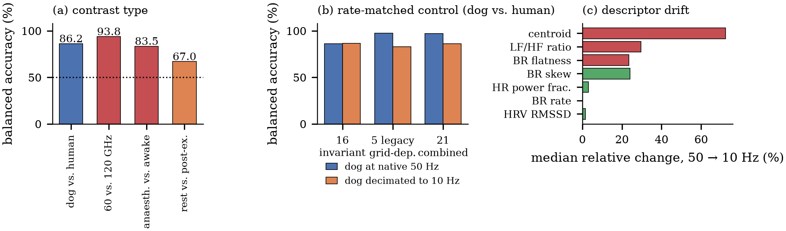
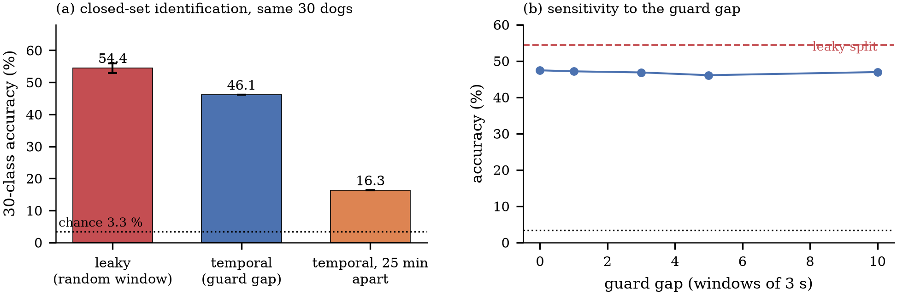

# Radar Cardiorespiratory Biometrics (`rcb`)

[](https://github.com/Xbotsd/Radar_Cardiorespiratory_Biometrics/actions/workflows/tests.yml)
[](LICENSE)
[](pyproject.toml)

Reference code, feature tables and result files for the study

> **Cross-species separability of radar cardiorespiratory signatures is no
> larger than cross-hardware separability: a leakage-aware re-evaluation of
> three public datasets**

Submitted to *Physiological Measurement* (IOP Publishing). Every number in the
manuscript is produced by the scripts in this repository from the public raw
data, and [`docs/NUMBERS.md`](docs/NUMBERS.md) maps each quoted value to the
result file and field it comes from.

---

## The question

Three public radar datasets — 30 dogs (7.3 GHz UWB), 110 adults (60 GHz FMCW)
and 24 adults (120 GHz FMCW) — are processed with one 20 Hz cardiorespiratory
chain. The study asks one question in three settings: **how much of a reported
cardiorespiratory "biometric" score survives when the evaluation protocol is
made honest?**

| Setting | Honest protocol | Result |
|---|---|---|
| Vital signs | recording level vs. synchronised reference | HR MAE 1.54 bpm (120 GHz), BR MAE 1.27 bpm (dogs) |
| Individual identification | temporal-block split with a guard gap | 46.1 % (30 dogs, 13.8× chance) vs. 54.4 % for the leaky random-window split |
| Open set | 10 known / 20 unknown dogs, threshold calibrated on held-out windows | 86.7 % accept / 19.3 % reject, AUROC 0.525 — **chance**; the 89.6 % rejection of the original fixed split does not generalise |
| Cross-species | subject-grouped CV, 110 humans vs 30 dogs | 90.2 % accuracy / 86.2 % balanced — but a **same-species, cross-platform** control (110 adults at 60 GHz vs. 24 other adults at 120 GHz) reaches 94.2 % / 93.8 % |
| Grid dependence | dog channel decimated 50 Hz → 10 Hz | legacy grid-dependent descriptors lose 15 points of balanced accuracy; the 16 invariant descriptors lose 0.2 |

The last two rows are the central claim: on these public data a dog-vs-human
classifier is *less* separable than two human datasets recorded with different
radars, and the same species measured in two session states (anaesthetised vs.
awake dogs) is separable at 83.5 % balanced accuracy. Cardiorespiratory
features therefore track **acquisition condition and physiology**, not species,
and a cross-species radar claim cannot be made from public data without a
same-radar, same-session animal/human recording.



*Balanced accuracy of the species contrast against three same-data negative
controls. The cross-platform control is the hardest to separate, not the
easiest.*



*Left: closed-set identification of 30 dogs under a random-window split, a
subject-grouped temporal split and a 25 min horizon. Right: the result is flat
in the guard gap, so the drop is not caused by adjacent-window overlap.*

---

## Repository layout

```
src/rcb/            installable package (no notebooks, no globals)
  config.py         dataset paths, constants (RCB_DATA_ROOT)
  io.py             loaders for the three datasets (+ float32 cache)
  dsp.py            filters, polyphase resampling, windowing, weighted median
  features.py       19-D identification set, 16-D invariant set, grid-dependent controls
  vitals.py         multi-range-bin estimator with harmonic notching, baselines
  stats.py          Bland-Altman / agreement, cluster bootstrap, Wilson CI
scripts/
  run_all.py              run every stage in order (or --figures only)
  00_cache_dogs.py        one-off CSV -> .npy conversion (3.5 GB cache)
  01_extract_features.py  all window-level feature tables
  02_vital_signs.py       recording- and window-level vital-sign results + ablation
  03_identification.py    closed-set (3 protocols) and open-set (repeated partitions)
  04_cross_species.py     cross-species, 3 negative controls, transfer, permutation test
  05_rate_matched_age.py  rate-matched control + age negative result
  06 make_figures.py      figures/*.pdf + *.png
  07_number_table.py      docs/NUMBERS.md (claim -> result field)
results/            every table the manuscript cites (CSV + JSON)
figures/            manuscript figures (regenerated by scripts/06)
docs/               DATA.md, PROTOCOL.md, NUMBERS.md, 使用说明.md
paper/              the submitted manuscript and cover letter
tests/              39 unit + end-to-end smoke tests
```

## Quick start

```bash
python -m pip install -r requirements.txt     # or: pip install -e .
export RCB_DATA_ROOT=/path/to/Biometric_Project   # Windows: $env:RCB_DATA_ROOT=...

python scripts/run_all.py                # ~15 min after the one-off cache
python scripts/run_all.py --from 03      # resume from one stage
python scripts/run_all.py --figures      # figures + number table only
pytest -q                                # 39 passed, no raw data needed
```

Everything is deterministic (`SEED = 42`), single-machine, CPU only.

## Data

None of the raw datasets are redistributed here. [`docs/DATA.md`](docs/DATA.md)
lists the three sources, their DOIs, the exact folder layout the loaders expect,
and the checksum-verified record counts. All three are public and were obtained
directly from their publishers.

## What is *not* in this repository

* No trained model weights: every model is refit from the feature tables in a
  few seconds (`scripts/02`–`05`). There is nothing to withhold.
* No synthetic or interpolated data: the rate-matched control decimates and
  re-featurises real radar recordings, it does not generate signals.
* No hyper-parameter search on the test data: all model settings are fixed
  before evaluation ([`docs/PROTOCOL.md`](docs/PROTOCOL.md)).

## Reproducing the headline numbers

| Manuscript statement | Command | File |
|---|---|---|
| HR MAE 1.54 bpm, 120 GHz, n = 48 | `02_vital_signs.py` | `results/vitals_summary.json` |
| BR MAE 1.27 bpm, 10 dogs | `02_vital_signs.py` | `results/vitals_summary.json` |
| 46.1 % temporal-block, 54.4 % leaky | `03_identification.py` | `results/identification_summary.json` |
| open-set 84 %/23 %, AUROC 0.53 | `03_identification.py` | `results/identification_summary.json` |
| 90.2 % species, 94.2 % cross-platform control | `04_cross_species.py` | `results/cross_species_summary.json` |
| grid-dependent descriptors collapse 50→10 Hz | `05_rate_matched_age.py` | `results/rate_matched_age_summary.json` |

The complete claim-by-claim mapping is in [`docs/NUMBERS.md`](docs/NUMBERS.md);
a Chinese walkthrough is in [`docs/使用说明.md`](docs/使用说明.md).

## Paper

* `paper/PMEA_manuscript.pdf` — submitted version (structured abstract,
  Harvard references, figures and tables in place)
* `paper/cover_letter.pdf` — cover letter sent with the submission
* `paper/SUBMISSION.md` — checklist used before submission and the manual
  steps that remain (ORCID confirmation, reviewer suggestions, declaration
  form)

## Citation

See [`CITATION.cff`](CITATION.cff). If you use the code before the article
appears, cite the repository and the three datasets listed in
[`docs/DATA.md`](docs/DATA.md).

## License

MIT for the code (see [`LICENSE`](LICENSE)). The datasets keep their own
licences; derived feature tables in `results/features/` are released under the
same MIT terms as the code.

## Contact

Yudong Xu — School of Mechanical Engineering, Heilongjiang University of
Science and Technology, Harbin 150022, China — 3468858545@qq.com —
ORCID [0009-0002-3231-0444](https://orcid.org/0009-0002-3231-0444)
